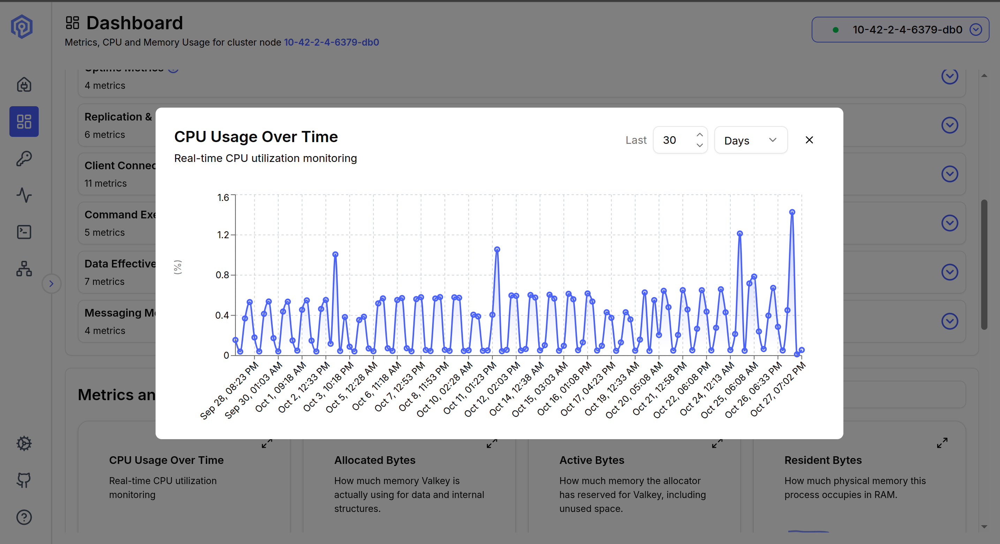
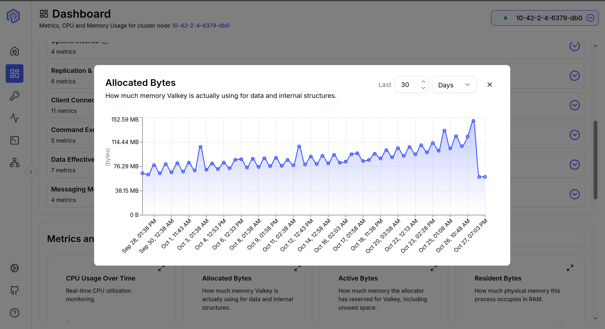

# Metrics Backfill

Populates Valkey Admin's CPU and memory charts with synthetic historical data when running in Kubernetes. Use this to demo the **Last 30 Days** feature without waiting weeks for real data to accumulate.

## How it works

`backfill.sh` runs entirely via `kubectl` — no local Node.js needed. It:

1. Finds the `valkey-admin` pod in the cluster
2. Locates the metric data directories inside the pod
3. Copies `gen-metrics.mjs` into the pod and runs it for each Valkey node
4. Renames the generated files to match the naming pattern Valkey Admin reads
5. Restarts the pod process so the server picks up the new files

## Requirements

- `kubectl` configured and pointing to the right cluster
- Valkey Admin pod running (`kubectl get pods -n demo-cluster`)
- **You must connect to the Valkey cluster in the Valkey Admin UI first** — the node data directories are only created after the first connection

## Usage

```bash
export KUBECONFIG=/path/to/your/kubeconfig.yaml

./metrics-backfill/backfill.sh [days] [namespace]
```

| Argument | Default | Description |
|---|---|---|
| `days` | `45` | Days of history to generate (use 45 for a 30-day view + 15 days outside the window) |
| `namespace` | `demo-cluster` | Kubernetes namespace where Valkey Admin is deployed |

**Example — generate 45 days in the default namespace:**
```bash
./metrics-backfill/backfill.sh 45
```

**Example — custom namespace:**
```bash
./metrics-backfill/backfill.sh 45 my-namespace
```

## Demo flow

```
1. kubectl apply -f k8s-cluster/valkeycluster.yaml
2. kubectl apply -f k8s-cluster/valkey-admin.yaml
3. kubectl apply -f k8s-cluster/load-generator.yaml
4. Port-forward and open the UI → connect to the cluster
5. ./metrics-backfill/backfill.sh 45
6. Wait ~15 seconds for the pod to restart
7. Open Dashboard → expand a chart → select Last 30 Days
```

## Result

After running the script, open the Dashboard in Valkey Admin, expand any chart and select **Last 30 Days**:

**CPU Usage Over Time — Last 30 Days**


**Allocated Bytes — Last 30 Days**


## Clean up synthetic data

```bash
kubectl exec -n demo-cluster <pod-name> -- sh -c \
  "find /app/apps/server/data -name 'cpu_*_0.ndjson' -o -name 'memory_*_0.ndjson' | xargs rm"
```

Then restart the pod:
```bash
kubectl exec -n demo-cluster <pod-name> -- sh -c "kill 1"
```
